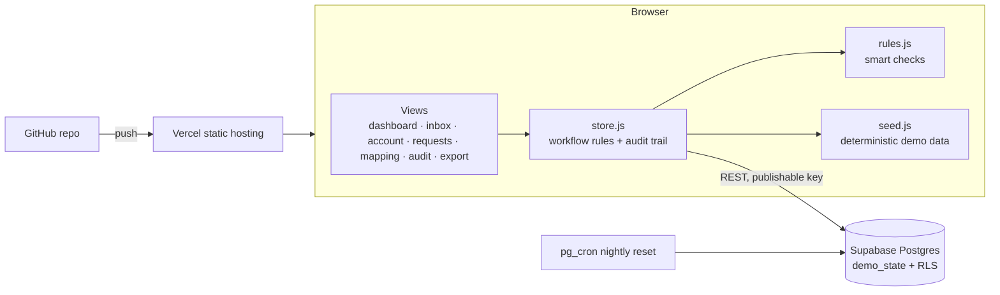

# Global COA Alignment

**One place to design, debate, approve and map a new global standard chart of accounts for SAP S/4HANA.**

> Demo company: **JIB Industrial Auto Supply (Fictional)**. All companies, people and figures in this project are invented.

## The problem

Rolling out one global chart of accounts across 200+ legal entities is mostly a people problem. Every entity, region and function has a view. When the work runs on Excel files, email threads and several disconnected tools, you lose track of:

- which version of an account is current
- who agreed, who objected, and why
- which local "must-have" accounts are really reporting dimensions in disguise
- how thousands of legacy accounts map to the new chart

This app keeps all of that in one workflow with a full audit trail.

## Try it

Pick a role on the start screen and switch at any time:

| Role | What you can do |
|---|---|
| **Global Head of Accounting** | Approve, reject or return accounts; decide escalated requests; resolve any objection; bulk-approve clean accounts |
| **Regional Controller** (Americas / EMEA / APAC) | Recommend or return accounts and local requests for the region; resolve objections from the region's entities; remediate legacy mapping conflicts |
| **Entity Accounting Analyst** (30 entities) | Fit-check every account (*Fits / Needs change / Can't use*); raise a formal objection that blocks approval; request a country or new global account |

## What it does

| Screen | Highlights |
|---|---|
| **Alignment dashboard** | Wave 1 of 4 (30 of 214 entities); approval pipeline; adoption by region; fit-check completion per entity; approver queues; most-contested accounts |
| **My inbox** | Role-specific queue with one-click actions and bulk actions for accounts without objections |
| **Account detail** | Workflow stepper, entity-by-entity votes, objections with resolution, S/4HANA attributes, full history |
| **Requests** | Live "is this an account or a dimension?" and duplicate checks as the analyst types |
| **Legacy mapping** | ~600 accounts from SAP ECC, Oracle EBS and local ERPs; 1:1 / N:1 / 1:N; open-item and reconciliation-account conflict checks with remediation |
| **Audit trail** | Append-only log of every decision, exportable to CSV |
| **S/4HANA export** | Cutover readiness check and load files modeled on the Migration Cockpit G/L account template |

## SAP S/4HANA design assumptions

- One **global operational chart of accounts** (`JGCA`) plus **country (alternative) charts** for statutory reporting
- **8-digit, range-based numbering**: 1 assets · 2 liabilities · 3 equity · 4 revenue · 5–7 cost of sales / opex · 8 other · 9 secondary cost
- Universal Journal aware: cost elements are G/L accounts, so Controlling is in scope; analysis belongs in profit center, segment and functional area, not extra accounts
- US GAAP leading ledger (0L); IFRS and local GAAP as parallel ledgers
- Post-go-live change governance is out of scope. That is the job of SAP MDG-F.

## Architecture



- **No build step.** Plain ES modules, hand-built SVG charts, zero runtime dependencies.
- **Shared state:** one JSON document in Supabase, secured with row-level security. Everyone sees the same program, and a nightly `pg_cron` job resets it. If Supabase is unreachable, the app falls back to local demo data in the browser.
- **Deterministic seed:** every reset produces the same story.

### AI-ready checks

`js/rules.js` holds the smart checks: account-vs-dimension, duplicate names, number range vs. account type, mapping attribute conflicts, mapping suggestions. They are rule-based today. Each function is a seam that a Claude API call can replace (for example, a model reading the justification and the local statute) without changing the UI.

## Run locally

```bash
python3 -m http.server 8000   # then open http://localhost:8000
```

## Deploy your own

1. Create a Supabase project and run [`supabase/schema.sql`](supabase/schema.sql) in the SQL Editor.
2. Put the project URL and **publishable** key in [`js/config.js`](js/config.js). Never the secret key.
3. Import the repo in Vercel (framework preset: *Other*, no build command).

## Roadmap

- Normalized tables (accounts, votes, objections, audit) with per-user auth
- Specialist reviewers: Tax, FP&A, Treasury, SAP/IT, Internal Audit
- Claude-powered checks and feedback summaries
- Country chart designer and translation workflow

See [`docs/requirements.md`](docs/requirements.md).

---
Built by Jay Blandford with Claude.
